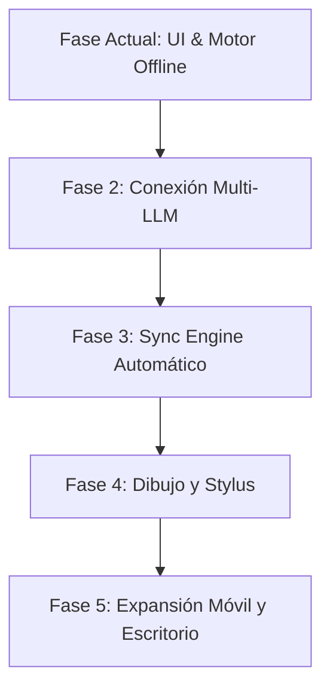

# Notia 🎙️📝

> **Aplicación de notas inteligente multiplataforma, offline-first y centrada en la privacidad.**  
> Graba, transcribe localmente sin conexión con **Sherpa ONNX** y estructura tus ideas mediante Inteligencia Artificial adaptada a tus necesidades.

---

## 📖 Visión General

**Notia** es una aplicación moderna de toma y gestión de notas construida con **Flutter**. Su propósito es transformar la captura de ideas mediante un enfoque híbrido:
1. **Captura inmediata y sin fricción:** Notas de voz o notas mecanografiadas con fluidez instantánea.
2. **Transcripción 100% privada y local:** Procesamiento de voz a texto en el propio dispositivo sin enviar audio a servidores externos mediante **Sherpa ONNX** y modelos cuantizados en español.
3. **Estructuración inteligente:** Organización contextual de la información mediante modelos de lenguaje (LLM) configurados con perfiles de uso (reuniones, estudio, ideas, proyectos).
4. **Formato libre y duradero:** Todas las notas se almacenan en archivos estándar **Markdown (`.md`)** con encabezados **YAML Frontmatter**, garantizando cero dependencia de formatos propietarios (*no vendor lock-in*).

---

## 🚀 Estado Actual del Proyecto (Lo que es ahora)

El proyecto cuenta con una base sólida de arquitectura limpia (**Clean Architecture + Feature-First**) y gestión de estado con **Bloc/Cubit**, con las siguientes características implementadas y verificadas:

### 1. 🎙️ Motor de Grabación y Transcripción Offline
- **Grabación nativa:** Configurado para captura de audio a 16 kHz Mono WAV de alta fidelidad.
- **Sherpa ONNX:** Integración con reconocedor de voz local Whisper Tiny en español sin necesidad de conexión a internet.
- **Preservación dual:** Separación en la misma nota entre la *transcripción cruda* generada por el reconocedor y el *contenido estructurado*.
- **Aislamiento en segundo plano:** Preparado para ejecutar la inferencia acústica sin congelar la interfaz visual (60/120 FPS).

### 2. 🏠 Pantalla Principal (Home)
- **Conmutador Dual 3D:** Selector táctil con relieve y swipe horizontal bidireccional para alternar entre grabación de voz y entrada escrita.
- **Perfiles de Grabación IA:** Menú de acceso rápido con 5 perfiles (`General`, `Reunión`, `Estudio`, `Ideas`, `Resumen`).
- **Transición in-screen de grabación:** Al iniciar una grabación, el dock inferior se reemplaza dinámicamente por controles de captura activos (*Descartar*, *Pausar / Reanudar*, *Detener y Procesar*).
- **Dock flotante estilizado:** Barra inferior minimalista con accesos a creación de carpetas, recordatorios, buscador e importación de audio.

### 3. 📚 Visualizador y Gestor de Notas
- **Modos de Vista:** Alternancia instantánea entre cuadrícula (2 columnas) y lista (1 columna).
- **Barra de Filtros:** Categorías por *Todas*, *Favoritos*, *Notas de Voz*, *Notas Escritas*, *Borradores* y *Papelera*.
- **Indicador de Transcripción Cruda (🔴):** Punto rojo distintivo en tarjetas de notas que indica que la nota solo contiene texto crudo pendiente de estructurar por IA. Al procesarse, el indicador desaparece.
- **Modo de Selección Múltiple:** Activación por pulsación prolongada (*long press*) con indicador circular púrpura. La barra de búsqueda inferior se transforma fluidamente en una barra de acciones masivas (*Mover*, *Bloquear*, *Compartir*, *Eliminar*, *Más*).
- **Navegación fluida:** Botón flotante de retorno al inicio (`^`) que aparece reactivamente durante el scroll, y botón flotante de creación rápida anclado al lateral derecho.

### 4. 🔍 Previsualización de Notas (Preview Modal)
- **Apertura con fondo difuminado:** Al tocar cualquier nota, se despliega una tarjeta de lectura sobre un fondo con desenfoque gaussiano suave (`BackdropFilter`).
- **Secciones múltiples:** `PageView` deslizable entre:
  - *Página 0:* Transcripción Cruda (Sherpa ONNX).
  - *Página 1:* Nota Organizada por IA.
- **Pin de Vista Predeterminada (📌):** 
  - La chincheta se muestra de **color rojo sólido** en la sección que está configurada para abrirse por defecto.
  - Se muestra **hueca** en la sección alterna.
  - Un toque sobre el pin cambia la preferencia y la fija como vista inicial predeterminada.
- **Paginación dots:** Indicadores de página centrados en la parte inferior.
- **Barra inferior con Popover `+`:**
  - `audio`: Grabación o inserción de notas de voz.
  - `pregunta ia`: Asistente de inteligencia artificial y reestructuración bajo demanda.
  - `imagen`: Inserción de imágenes desde la cámara o la galería.
  - `más opciones`: Suite completa de edición con 6 categorías (listas y tareas con casillas interactivas, formato tipográfico, multimedia, dibujo a mano alzada, edición estructural/tablas y control de cambios).

### 5. 🎨 Recursos e Iconografía Local
- Total independencia de CDNs y recursos externos: paquete completo de iconos locales optimizados en `assets/icons/`.
- Tipografía moderna **Figtree** con pesos jerárquicos definidos.

---

## 🔮 Roadmap: Lo que se planea hacer

El desarrollo futuro de Notia se enfoca en las siguientes etapas estratégicas:



### 1. 🧠 Integración Completa Multi-LLM (Agnóstica)
- **Conectores configurables:** Soporte para **Google Gemini**, **OpenAI (GPT-4o)**, **DeepSeek** y cualquier servidor local compatible con API OpenAI (como **Ollama** o **Groq**).
- **Almacenamiento Seguro:** Gestión de claves API mediante `flutter_secure_storage` (cifrado con Keystore en Android y Credential Manager en Windows).
- **Pipeline de Estructuración por Perfil:** Procesamiento automático del texto crudo utilizando prompts diseñados para cada perfil (extraer acuerdos de reuniones, esquematizar apuntes de clase, generar listas de tareas accionables).

### 2. ☁️ Motor de Sincronización Automática (Sync Engine)
- **Sincronización reactiva y condicional:** El motor solo se activa si hay conexión activa (`connectivity_plus`), ahorrando batería y evitando errores innecesarios.
- **Disparadores inteligentes:** Al iniciar la app, al recuperar conexión o al editar una nota (con debounce).
- **Resolución Last-Write-Wins:** Detección de versiones mediante marcas temporales UTC en el YAML Frontmatter.
- **Flexibilidad de almacenamiento:** Soporte planificado para proveedores en la nube y protocolos abiertos (WebDAV, Nextcloud, S3 o Firebase).

### 3. ✏️ Lienzo de Dibujo a Mano Alzada y Stylus
- Implementación del lienzo vectorial sensible a la presión para lápiz óptico y pantalla táctil.
- Herramientas activas: lápiz, pluma caligráfica, borrador por trazos y lazo de selección para mover y escalar dibujos.

### 4. 🎨 Personalización Estética y Temas
- Personalización avanzada de paletas de colores (modos temáticos seleccionables por el usuario).
- Soporte para etiquetas personalizadas, carpetas anidadas y filtros avanzados.

### 5. 📱 Plataformas y Despliegue
- **Fase 1 (En desarrollo):** Android, Windows y Linux.
- **Fase 2:** iOS y macOS.

---

## 🏗️ Arquitectura de la Base de Código

El código está estructurado siguiendo los principios de **Clean Architecture** orientada a características (**Feature-First**):

```
lib/
├── core/
│   ├── constants/          # Constantes globales y rutas de iconos (AppIcons)
│   ├── network/            # Verificación de conectividad (NetworkInfo)
│   ├── storage/            # Almacenamiento seguro de claves API (SecureStorageService)
│   ├── theme/              # Tokens de estilo, tipografía Figtree y colores
│   └── widgets/            # Widgets reutilizables de diseño base
├── features/
│   ├── audio_recorder/     # Servicios de audio a 16kHz, eventos y estados BLoC
│   ├── home/               # Pantalla principal, conmutador 3D, perfiles y dock
│   ├── notes/              # Modelo Note, YAML Frontmatter, visor de notas y preview modal
│   └── transcription/      # Servicios de Sherpa ONNX y gestor de modelos STT
└── main.dart               # Punto de entrada de la aplicación
```

---

## 🛠️ Cómo Ejecutar el Proyecto

### Requisitos previos
- [Flutter SDK](https://docs.flutter.dev/get-started/install) (versión 3.24 o superior).
- Dart SDK compatible.
- Herramientas de compilación de la plataforma de destino (Android Studio / Visual Studio C++ para Windows / Clang y CMake para Linux).

### Instalación y ejecución

1. **Clonar el repositorio:**
   ```bash
   git clone https://github.com/Noukah/New-Notia.git
   cd New-Notia
   ```

2. **Obtener dependencias:**
   ```bash
   flutter pub get
   ```

3. **Ejecutar pruebas unitarias y de widgets:**
   ```bash
   flutter test
   ```

4. **Iniciar la aplicación:**
   ```bash
   # Para Windows:
   flutter run -d windows

   # Para Android:
   flutter run -d <device_id>

   # Para Linux:
   flutter run -d linux
   ```

---

## 📄 Licencia

Este proyecto está bajo desarrollo activo por **Noukah**. Todos los derechos reservados.
